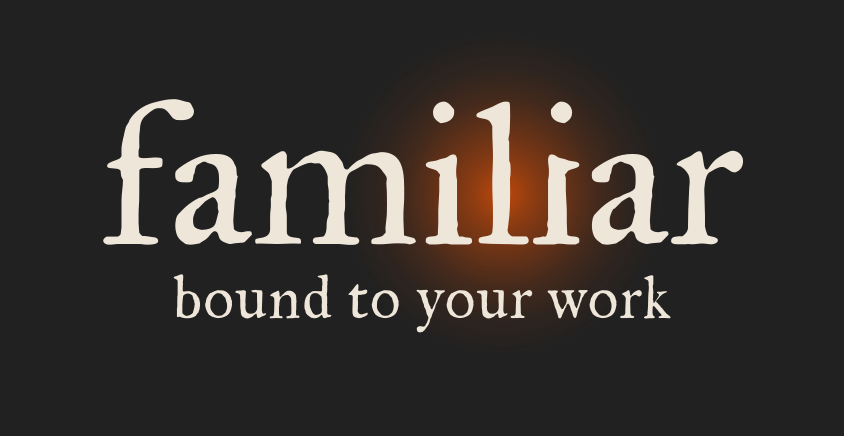
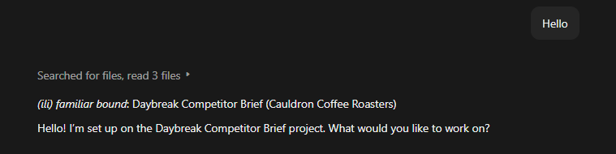
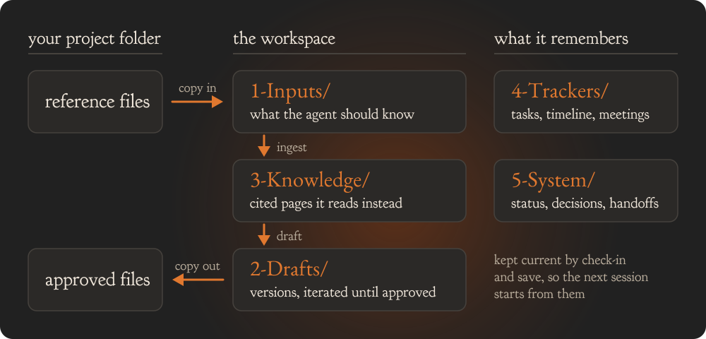

  

  <strong>A project-memory and workflow layer that makes AI agents instantly familiar with your work, progress, and decisions.</strong>

  
  

  <a href="https://github.com/familiar-md/familiar/releases">Download</a> ·
  <a href="https://familiar-md.github.io/familiar/">Docs</a> ·
  <a href="https://familiar-md.github.io/familiar/start/your-first-session/">Your first session</a> ·
  <a href="https://familiar-md.github.io/familiar/quick-reference/">Skills quick reference</a>

  Extensions:
  <a href="https://github.com/familiar-md/familiar-hub">Fleet hub</a> ·
  <a href="https://github.com/familiar-md/familiar-hooks">Hooks</a> ·
  <a href="https://github.com/familiar-md/familiar-template">Build your own</a>

Download one folder, give it your project's name, and open your AI coding agent inside it. Every
session then starts from the project's record instead of from nothing.

  

- **Remembers the project.** What it is, what has been decided, what is open, and where each fact
  came from, kept as plain Markdown in the folder.
- **Answers from your sources.** Claims trace to your own documents with a page or section locator,
  not to the model's memory.
- **Workflows built in.** Check-ins, ingesting sources, deliverable briefs, Word, PowerPoint and Excel
  drafts, research and handoffs.
- **Free, open source, and yours.** Plain Markdown and a few small scripts: no account, no server,
  nothing to sign up for. Every rule, skill and template is a file you can read and change. Nothing
  is stored outside the folder; the agent you open in it sends what it reads to its own provider,
  under that provider's terms.

  

## Get started

1. Download `familiar-workspace-<version>.zip` from the [Releases page](https://github.com/familiar-md/familiar/releases) and unzip it.
2. Rename the folder to your project's name.
3. Open your AI coding agent inside it: Claude Code, Codex or Gemini CLI.
4. Run `/ili-project-status check-in`. It reads what is already in the folder and asks only what the files cannot answer.

Walkthrough: [Your first session](https://familiar-md.github.io/familiar/start/your-first-session/). Supported agents and requirements: [Works with](https://familiar-md.github.io/familiar/start/works-with/).

## Learn more

The guide, skills quick reference, manual and install notes are on the [documentation site](https://familiar-md.github.io/familiar/); the same text is in this repo as [`docs/using-familiar.md`](docs/using-familiar.md), [`INSTALL.md`](INSTALL.md), [`MANUAL.md`](MANUAL.md) and [`QUICK-REFERENCE.md`](QUICK-REFERENCE.md). What changed in each release: [`CHANGELOG.md`](CHANGELOG.md).

## License

Apache License 2.0. See [`LICENSE`](LICENSE).
