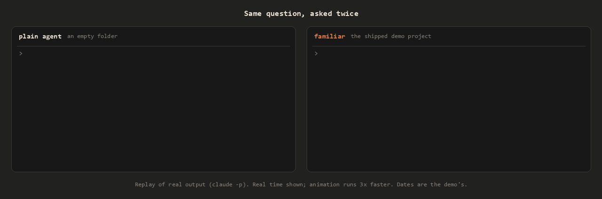
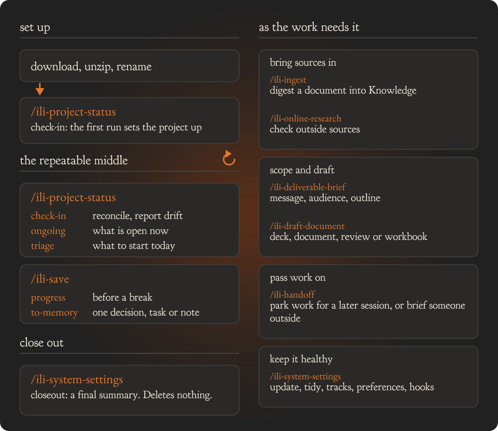
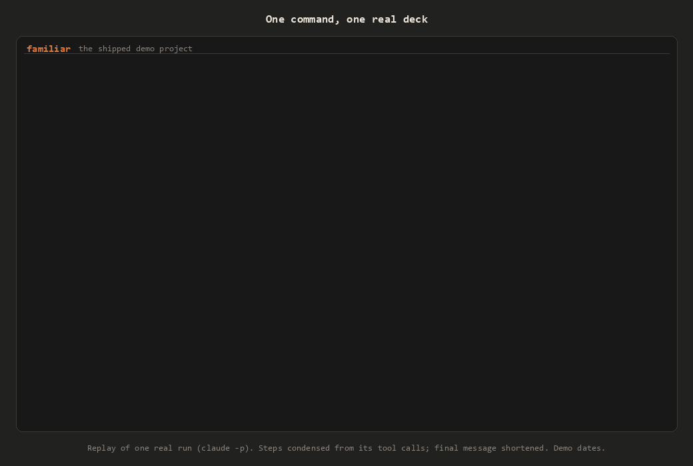

  

  <strong>A project-memory and workflow layer that makes AI agents instantly familiar with your work, progress, and decisions.</strong>

  
  

  <a href="https://github.com/familiar-md/familiar/releases">Download</a> ·
  <a href="https://familiar-md.github.io/familiar/">Docs</a> ·
  <a href="https://familiar-md.github.io/familiar/start/your-first-session/">Your first session</a> ·
  <a href="https://familiar-md.github.io/familiar/quick-reference/">Skills quick reference</a>

  Extensions:
  <a href="https://github.com/familiar-md/familiar-hub">Fleet hub</a> ·
  <a href="https://github.com/familiar-md/familiar-hooks">Hooks</a> ·
  <a href="https://github.com/familiar-md/familiar-template">Build your own</a>

familiar is simple: one folder and one AI coding agent. No installer to run, no MCP server to
connect, no custom harness to learn. Download the folder, give it your project's name, and open
your agent inside it. Every session then starts from the project's record instead of from nothing.

  

- **Remembers the project.** What it is, what has been decided, what is open, and where each fact
  came from, kept as plain Markdown in the folder.
- **Answers from your sources.** Claims trace to your own documents with a page or section locator,
  not to the model's memory.
- **Workflows built in.** Check-ins, ingesting sources, deliverable briefs, Word, PowerPoint and Excel
  drafts, research and handoffs.
- **Free, open source, and yours.** Plain Markdown and a few small scripts: no account, no server,
  nothing to sign up for. Every rule, skill and template is a file you can read and change. Nothing
  is stored outside the folder. The agent you open in it sends what it reads to its own provider,
  under that provider's terms.

  

  

  

  

## Who it is for

Anyone whose work is a set of separate projects, each with its own documents, decisions and open
questions:

- **Lawyers** keeping a file per matter: pleadings, correspondence, deadlines, and what was decided
  and why.
- **Consultants** juggling several clients or engagements, each needing its own record and deliverables.
- **Researchers and analysts** tracking sources, findings and the claims that rest on them.
- **Grant writers and proposal teams** assembling drafts from a shared pile of reference material.
- **Project and program managers** carrying status, risks and decisions across long-running work.
- **Product managers** keeping specs, research and decision logs for each initiative.
- **Journalists and writers** running a story or a book as a project, with sources and drafts.
- **Freelancers and agencies** handing work between clients without losing the thread.
- **Accountants and advisors** keeping a working file per engagement.

One folder per project, so each matter, client or engagement keeps its own record.

> **Privacy is not part of this project.** familiar is plain Markdown files and small scripts. It
> adds no encryption, access control, redaction or confidentiality protection. It makes no compliance
> claims. Whatever your AI agent reads from the folder goes to that agent's provider, under the
> provider's terms. Your work can carry confidentiality duties: client privilege, NDAs, health or
> personal data, employer policy. If it does, check that your agent, its settings and your folder's
> sync or backup location meet them before you put that material in. That responsibility is yours.

1. Download `familiar-workspace-<version>.zip` from the [Releases page](https://github.com/familiar-md/familiar/releases) and unzip it.
2. Rename the folder to your project's name.
3. Open your AI coding agent inside it: Claude Code, Codex or Gemini CLI.
4. Run `/ili-project-status check-in`. It reads what is already in the folder and asks only what the files cannot answer.

Walkthrough: [Your first session](https://familiar-md.github.io/familiar/start/your-first-session/). Supported agents and requirements: [Works with](https://familiar-md.github.io/familiar/start/works-with/).

## Learn more

The guide, skills quick reference, manual and install notes are on the [documentation site](https://familiar-md.github.io/familiar/); the same text is in this repo as [`docs/using-familiar.md`](docs/using-familiar.md), [`INSTALL.md`](INSTALL.md), [`MANUAL.md`](MANUAL.md) and [`QUICK-REFERENCE.md`](QUICK-REFERENCE.md). What changed in each release: [`CHANGELOG.md`](CHANGELOG.md).

## License

Apache License 2.0. See [`LICENSE`](LICENSE).
