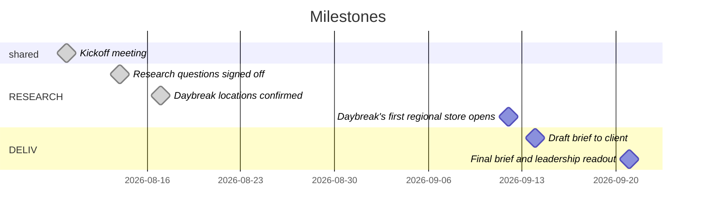

<!-- generated from timeline.md revision 1 on 2026-08-24 by .familiar/scripts/timeline_views.py; do not edit -- edit timeline.md and regenerate -->
# Timeline gantt

Rendered from `timeline.md`. Milestones without a full date are not drawn.

